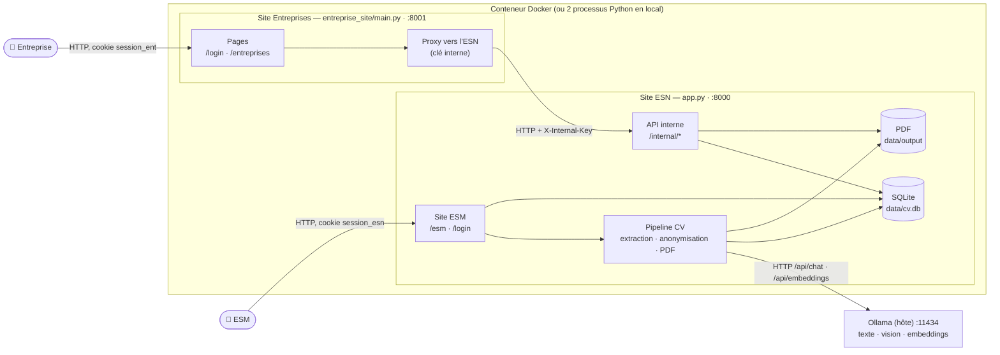
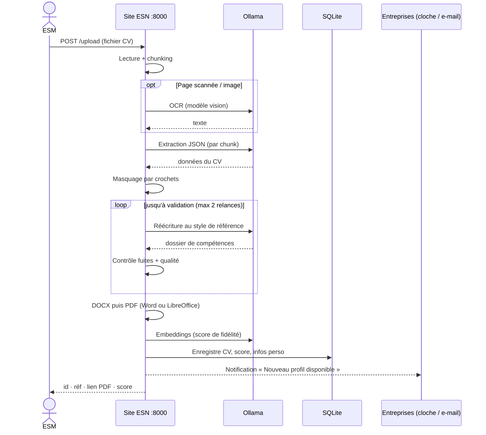
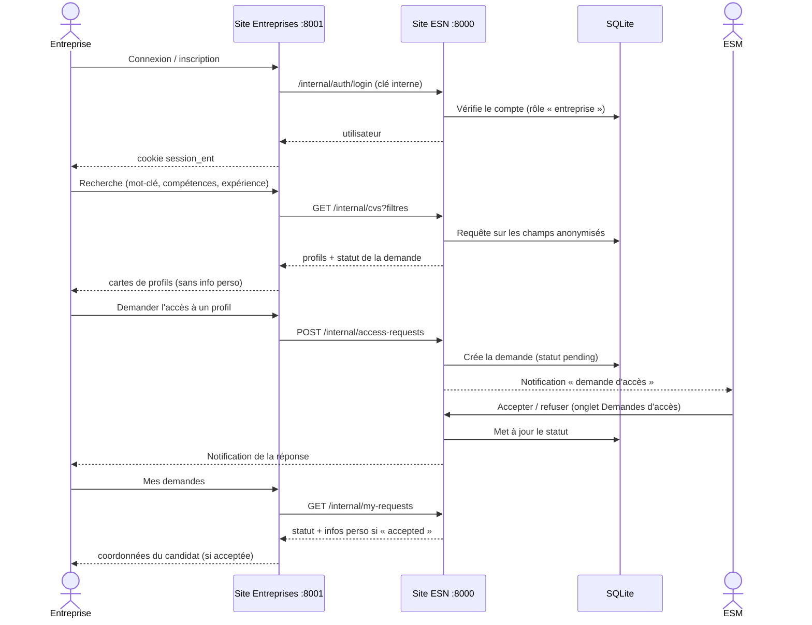
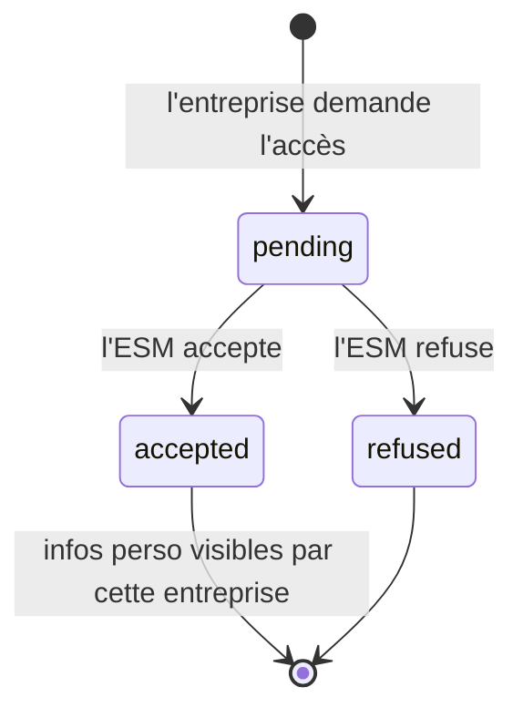

# Diagramme de flux

Qui parle à qui, et quelles données circulent. Pour le détail du traitement d'un CV, voir [diagramme-pipeline.md](diagramme-pipeline.md).

## Architecture : deux sites, deux ports

Principes de séparation :

- **Un seul propriétaire de la base** : l'ESN. Le site Entreprises n'a ni base, ni pipeline, ni accès à Ollama.
- **Le site Entreprises ne voit que de l'anonymisé** : l'API interne ne renvoie les champs personnels (nom, e-mail, téléphone, ville) qu'après une demande d'accès **acceptée** par l'ESM.
- **Deux cookies distincts** (`session_esn`, `session_ent`) : les cookies `localhost` sont partagés entre ports, sans cela les deux sites se déconnecteraient mutuellement.

## Flux 1 — Ajouter un CV (ESM)

## Flux 2 — Rechercher et demander l'accès (Entreprise)

## Cycle de vie d'une demande d'accès

Une seule demande par couple (CV, entreprise) : une seconde demande renvoie une erreur 409.

## Notifications

| Événement | Destinataire | Canaux |
|---|---|---|
| Nouveau CV traité | toutes les entreprises | cloche + e-mail* |
| Demande d'accès créée | tous les comptes ESM | cloche + e-mail* |
| Demande acceptée / refusée | l'entreprise concernée | cloche + e-mail* |

\* E-mail uniquement si `SMTP_HOST` est défini ; sinon un message est écrit dans la console du serveur.
