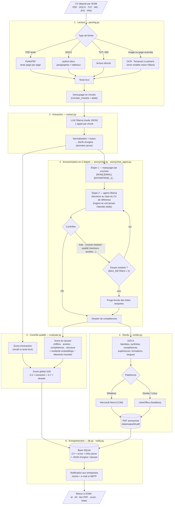
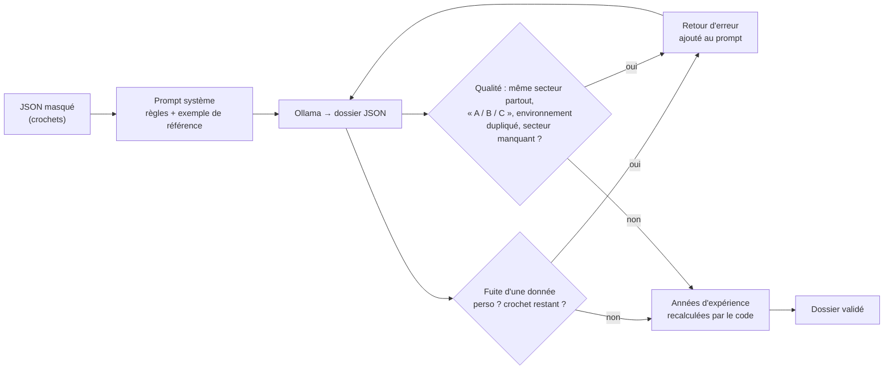

# Diagramme du pipeline

Traitement d'un CV, de l'upload au PDF anonymisé (`pipeline.py` → `process_cv`).
Les diagrammes sont en [Mermaid](https://mermaid.js.org/) : ils s'affichent dans VS Code (aperçu Markdown), GitHub et GitLab.

## Vue d'ensemble

## Étapes et fichiers produits

| # | Étape | Module | Modèle Ollama | Sortie |
|---|---|---|---|---|
| 1 | Lecture + chunking | `parsing.py` | vision (`qwen2.5vl:7b`) uniquement pour les scans | texte brut |
| 2 | Extraction | `extract.py` | `OLLAMA_MODEL` (JSON) | `data/json/<id>.json` |
| 3a | Masquage par crochets | `anonymise.py` | — (code déterministe) | `data/json/<id>.masked.json` |
| 3b | Réécriture au style de référence | `anonymise_agent.py` | `OLLAMA_MODEL` | `data/json/<id>.dossier.json` |
| 4 | DOCX puis PDF | `render.py` | — | `data/output/<id>.docx` / `.pdf` |
| 5 | Score de fidélité | `evaluate.py` | `nomic-embed-text` | `data/json/<id>.report.json` |
| 6 | Base + notifications | `db.py`, `notify.py` | — | ligne dans `data/cv.db` |

## Boucle de l'agent (étape 3b)

Règles de sécurité de l'étape : l'agent ne reçoit que le CV masqué ; toute donnée personnelle encore présente après les essais est remplacée de force par `[…]` ; les années d'expérience sont calculées en code (année la plus ancienne) puis imposées dans la synthèse.

## Gestion des erreurs

| Situation | Comportement |
|---|---|
| JSON invalide renvoyé par le LLM | jusqu'à 3 essais, température +0,2 à chaque essai |
| Page scannée | OCR Tesseract, sinon modèle vision (image limitée à 1600 px, 3 essais) |
| Ollama injoignable / modèle absent | erreur claire (HTTP 422) avec la commande `ollama pull` à lancer |
| Base injoignable | le CV est quand même généré ; l'erreur est renvoyée dans `excel_error` |
| Aucun texte lisible | erreur 422 |
